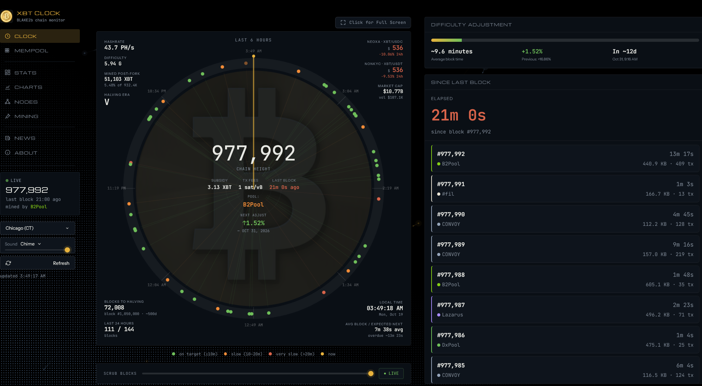

# Bitcoin (XBT) Clock + Hybrid Mempool + Stats

<p align="center">
  
</p>

A live single-page dashboard for **Bitcoin BLAKE2b (XBT)** — the BIP-110 hardfork that split from Bitcoin mainnet at block 961,632 and has run BLAKE2b proof-of-work since block 961,640 (30 Aug 2026).

**Live:** https://xbtclock.online/

 

<p align="center">
  
</p>

---

## Tabs

A fixed left sidebar (brand, tabs, time zone, sound, refresh, and a live card with the latest block height, its age, and the pool that mined it) switches between eight pages. The sidebar collapses behind a hamburger menu under ~980px wide, and the Clock and Mempool grids drop to one column under ~1510px. The last tab you used is remembered, and each tab has its own `#hash` link.

| Tab | What it shows |
| --- | --- |
| **Clock** | The block ring: chain height in the center, with recent blocks plotted around a selectable window (1h / 6h / 12h / 24h / 7d), colored by how their interval compared to the 600s target. Hashrate, difficulty, post-fork supply, halving era, live prices, market cap and local time in the corners; a scrub bar to rewind through loaded history; a full-screen button; a Since Last Block feed; difficulty adjustment progress. |
| **Mempool** | Search box (block height, block hash, transaction id or address), a strip of latest blocks with click-through block / transaction / address detail, Miner Propagation Report (24H / 7D / 30D), Recent Transactions, fee tiers, mempool size with a live-accumulated incoming chart, and Recent Replacements (RBF). |
| **Stats** | Price with a 1H to ALL chart, chain, difficulty, mining, fees and mempool cards, a latest-block card, 24h pool shares, next halving and the future halving / supply tables. |
| **Charts** | Hashrate, difficulty, fees, mempool and block size, each with its own range buttons. |
| **Nodes** | Node counts, node versions, coinbase-lock enforcement and sync status from the B2B Node Census, a nodes-over-time chart, and the XBT Network Nodes panel fed by the xbt-crawler project. |
| **Mining** | Mining pools pie and table (24H / 7D / 30D), live network inputs, and a mining calculator with estimated earnings. |
| **News** | Latest headlines from [XBT Watch](https://xbtwatch.com/?ref=home) (RSS). |
| **About** | What the dashboard is, a table of every data source, and a support address. |

Loaded block history is cached in `localStorage`, so a manual refresh doesn't force a full multi-page backfill again. Chart range choices are remembered per browser too. The background node-and-signal animation is skipped for visitors who ask for reduced motion.

No build step, no framework, no dependencies in the page itself — it's one `.html` file. Open it locally or host it anywhere that serves static files.

## How the data flows

```
browser ──► Cloudflare proxy (btcb2-proxy) ──► mempool.guide · neoxa.exchange · api.nonkyc.io · xbtwatch.com
   │
   ├──► xbt-api (Cloudflare Worker + D1)   history, pool shares, 24h high/low
   ├──► B2B Node Census (GitHub Pages JSON) node counts, versions, lock enforcement
   └──► crawl-latest.json / crawl-history.json (this repo, published by hand from xbt-crawler)
```

- **Live values** (tip, blocks, fees, mempool, prices, difficulty adjustment, recent transactions) are fetched by the page itself every few seconds through the proxy.
- **History** (charts, pool shares over 24H / 7D / 30D, 24h high and low) comes from `xbt-api`, which records the chain and market every minute.
- **Nodes** come from two places: the independent [B2B Node Census](https://lionthunderfingers.github.io/Bitcoin-Node-census/) for the headline counts, versions, lock enforcement and sync status, and this project's own crawler for chain-verified clearnet nodes.

## Data sources

| Source | What it provides | Auth |
| --- | --- | --- |
| [mempool.guide](https://mempool.guide) | Chain tip, blocks, difficulty adjustment, hashrate, mempool stats, fee estimates, recent transactions, RBF replacements, and block / transaction / address lookups — via the mempool.space-compatible REST API | None |
| [neoxa.exchange](https://neoxa.exchange/api-docs) | XBT/USDC ticker (the API's internal pair name is `BTCB2_USDC`) | None |
| [api.nonkyc.io](https://api.nonkyc.io) | XBT/USDT ticker (internal pair name `BTCB2_USDT`) | None |
| `xbt-api` (this repo, `xbt-api/`) | Price, hashrate, difficulty, fee, mempool and block-size history; mining pool shares; 24h high/low | None |
| [B2B Node Census](https://github.com/LionThunderFingers/Bitcoin-Node-census) | Hourly reachable-node counts, versions, coinbase-lock enforcement and sync status, read as static JSON | None |
| `crawl-latest.json`, `crawl-history.json` | Output of the xbt-crawler project (see below) | None |
| [xbtwatch.com](https://xbtwatch.com) | News headlines via its RSS feed | None |
| Google Fonts | Michroma, Instrument Sans, JetBrains Mono | None |

mempool.guide, Neoxa, NonKYC and XBT Watch **don't send permissive CORS headers**, so a browser can't call them directly from a page on another origin. Every request to them goes through a small Cloudflare Worker that fetches server-side and re-adds `Access-Control-Allow-Origin: *`. The census files are served by GitHub Pages and are read directly.

## The stats Worker (`xbt-api/`)

A Cloudflare Worker with a D1 database. A cron trigger runs it every minute:

- stores any new blocks (height, time, size, transaction count, fees, mining pool, difficulty from the block's `bits`);
- backfills older blocks toward the fork (80 blocks a minute, so full history takes roughly an hour on first run);
- records one market sample per minute: price (mean of the exchanges that answered), 24h volume, hashrate, mempool size, fee estimates and chain tip.

| Route | Returns |
| --- | --- |
| `/api/history?series=price\|hash\|diff\|fees\|mem\|size&range=1H\|1D\|7D\|1M\|3M\|YTD\|1Y\|5Y\|10Y\|ALL` | Up to ~300 averaged points for a chart |
| `/api/pools?period=1d\|1w\|1m` | Blocks per mining pool in the period |
| `/api/summary` | Latest price, 24h high/low, 144-block totals, first sample time |
| `/api/health` | Block and sample counts (a quick way to check it is collecting) |
| `/api/collect` | Runs one collection by hand (skipped if a sample is under 50 seconds old) |
| `/api/backfill-price` | One-off seed of price samples from Neoxa's newest trades |

A few things to know about the history:

- **Hashrate** is estimated from the stored blocks: difficulty × 2³² ÷ the time the last 24 blocks took. It has full history back to the fork. The live figure on the Clock tab comes from mempool.guide, so the last point can differ slightly.
- **Difficulty** is computed from each block's `bits`, not taken from mempool.guide, whose difficulty value is wrong by about 2³² for this chain.
- **Price and mempool** can't be backfilled (no history source), so those charts only start when the Worker was first deployed and fill in over time. Fees, block size, difficulty and hashrate have full history.

### Deploy the Worker

From the `xbt-api/` folder, with Node installed:

```
npm i -g wrangler
wrangler login
wrangler d1 create xbt-stats
```

Copy the `database_id` it prints into `wrangler.toml` (the binding must stay `DB`), then:

```
wrangler d1 execute xbt-stats --remote --file=schema.sql
wrangler deploy
```

Open `<your Worker address>/api/health` after a couple of minutes: `samples` should be rising and `blocks` growing. If `wrangler login` times out, create an API token from the Cloudflare dashboard (**Edit Cloudflare Workers** template plus **D1: Edit**) and set it as `CLOUDFLARE_API_TOKEN` for the session. Don't commit tokens to the repo.

Then point the page at it with the `window.XBT_API` line near the top of `index.html`.

## Node data

Two sources feed the Nodes tab.

**B2B Node Census** — an independent DNS-seed crawler that publishes `data.json`, `history.json` and `stable-nodes.json` hourly. It supplies the reachable and known node counts, stable nodes, node versions, coinbase-lock enforcement (from user-agent strings), sync status and the nodes-over-time chart. It counts nodes that signal the fork bit, so it is a lower bound.

**xbt-crawler** — a separate dependency-free Node.js project that connects to a local XBT node's RPC to seed a peer list, crawls the P2P network over raw sockets, and **fingerprints each peer by requesting a known post-fork block** via `getdata`. A `block` reply confirms XBT; `notfound` means it's a real Bitcoin or Knots node that happens to share the same magic bytes and port 8333. Running `node publish.js` there writes `crawl-latest.json` and `crawl-history.json`, which are uploaded here by hand. The XBT Network Nodes panel shows whatever was last published and stays at `—` until the files exist. Its figure is a clearnet, chain-verified lower bound (Tor and I2P nodes can't be probed), so it is deliberately lower than the census headline.

| File | What it is |
| --- | --- |
| `crawl-latest.json` | Latest crawl: stats (`xbtConfirmed`, `totalProbed`, ...) and the confirmed peer list |
| `crawl-history.json` | One compact entry per crawl run (capped at 365) |

The page never displays node addresses.

## Setup

1. **Deploy the CORS proxy.** Create a Cloudflare Worker with this code:

   ```js
   export default {
     async fetch(request) {
       const url = new URL(request.url).searchParams.get("url");
       if (!url) return new Response("Missing ?url=", { status: 400 });
       const upstream = await fetch(url, {
         headers: { "User-Agent": "Mozilla/5.0" },
       });
       const body = await upstream.arrayBuffer();
       return new Response(body, {
         status: upstream.status,
         headers: {
           "Access-Control-Allow-Origin": "*",
           "Content-Type":
             upstream.headers.get("content-type") || "application/json",
         },
       });
     },
   };
   ```

   Make sure it allows `xbtwatch.com`, `mempool.guide`, `neoxa.exchange` and `api.nonkyc.io` if you restrict hosts.

2. **Point the page at it.** In `index.html`, set `PROXY_PREFIX` (and `PROXY` in the News script) to `https://YOUR-WORKER.YOUR-SUBDOMAIN.workers.dev/?url=`.

3. **Deploy the stats Worker** as described above and set `window.XBT_API`.

4. **Serve the files.** Any static host works (GitHub Pages, Netlify, Cloudflare Pages). Upload `index.html`, plus `crawl-latest.json` and `crawl-history.json` if you run the crawler.

## Configuration

The important constants live in `CONFIG` near the top of the app `<script>` block:

| Constant | Meaning |
| --- | --- |
| `FORK_HEIGHT` | 961640 — the clock's "zero point" (BLAKE2b activation), not true Bitcoin genesis |
| `TARGET_BLOCK_SECONDS` | 600 — the inherited Bitcoin target, used for the ring's on-target / slow / very-slow coloring |
| `SUPPLY_CAP` | 21,000,000 — inherited issuance cap |
| `BLOCK_PAGES_ON_LOAD` / `BLOCK_PAGES_MAX_BACKFILL` | How much block history is fetched on load and how far it extends backward for longer ring windows (up to 7 days) |
| `REFRESH_CHAIN_MS` / `REFRESH_MARKET_MS` | Live polling intervals (5s by default) |
| `PROXY_PREFIX` | Your CORS proxy |
| `window.XBT_API` | Address of the stats Worker |
| `NODE_CRAWL_URL`, `NODE_HISTORY_URL`, `NODE_CRAWL_REFRESH_MS` | Paths to the crawler output (default `./crawl-latest.json`, `./crawl-history.json`, re-polled every 5 minutes) |

Default chart ranges (Stats price 1 day, Charts hashrate 7 days, difficulty 1 month, fees / mempool / block size 1 day, Nodes 7 days, Mining pools 24H) are set in the `rst` object in the first script.

## Capacity

At the default 5-second intervals, one continuously-open tab makes roughly **104,000 requests/day** through the proxy Worker, which is already past Cloudflare's free-plan cap of 100,000 requests/day with a single viewer. This project runs on **Workers Paid** ($5/mo, 10M requests included). To stay on the free plan, lengthen `REFRESH_CHAIN_MS` / `REFRESH_MARKET_MS` (10-15s still feels live and cuts volume by half to two-thirds). Modal lookups are on-demand and add little. Charts re-read from `xbt-api` once a minute while a tab is visible.

The stats Worker itself is light: one scheduled run a minute, about 15 upstream requests per run, and a small number of D1 writes (one sample a minute, plus new blocks) once the initial backfill is done.

## Notes

- This chain does **not** reset to a fresh genesis. It inherits Bitcoin's full pre-fork history, so block height continues from real Bitcoin mainnet numbering (~978,000 now).
- The "Mined post-fork" stat and market cap are deliberately different numbers: post-fork supply excludes everything inherited from before the fork, while market cap values the full circulating supply since true genesis.
- Block cards and modals get their fee ranges, totals and pool attribution from fields mempool.guide already computes server-side (`extras.feeRange`, `extras.totalFees`, `extras.pool`). Those need the `/v1/` endpoints; the plain `/block/:hash` endpoint doesn't include them.
- The coinbase transaction in a block's Transactions tab is detected via `vin[0].is_coinbase` and shown with the block's pool attribution.
- NonKYC's field names were reverse-engineered against their public v2 market endpoint; if their schema changes, that price degrades to `—` rather than breaking the page.
- Because XBT shares Bitcoin mainnet's magic bytes and port, most peers a crawl meets are real Bitcoin or Knots nodes, not XBT. The confirmed count is a lower bound, not a total.
- XBT is not BTC: they are separate coins on separate chains. Data is provided as is.

## License

[MIT with Attribution](LICENSE) — free to use, modify, and deploy, but any fork or deployment must visibly credit the original author and link back to this repo.
